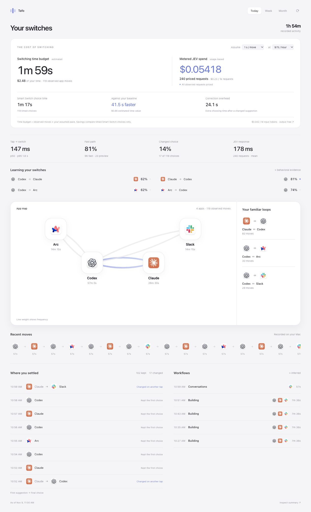

# Tafo

**Tab Around and Find Out.** An intelligent macOS app switcher built with BAML.

Tap to take a confident prediction. Tap again to browse alternatives. Hold to type
or dictate a destination. Tafo learns from the app you settle on.



*Illustrative demo data. The dashboard shows model spend, an adjustable time-value
scenario, measured switching latency, learning progress, and observed app patterns.*

## Install the app

Download the Apple Silicon ZIP from [Releases](https://github.com/BoundaryML/demo-tafo/releases),
unzip it, and move **Tafo.app** to Applications. Open it and enable its Accessibility
permission. No Rust or BAML installation is required. These previews are ad-hoc
signed, not Apple-notarized; macOS may require approval in Privacy & Security.

Tagged releases include a write-only telemetry key for the production Cloud
environment. Manual CI previews use the separate shared dev environment. They upload app-switching traces and activity aggregates there;
pausing tracking stops capture and background predictions. Source builds leave
Cloud off by default. No model API key is distributed.

For semantic predictions, put `JEV_API_KEY=...` in
`~/Library/Application Support/Smart Switch/.env` and set its permissions to `600`.
Exact app-name matching and recent-app switching work without it.

## Build from source

Requires macOS 13+, Xcode command-line tools, Rust (the pinned toolchain is selected
by rustup), Python 3, and the [BAML CLI](https://developer.boundaryml.com/).

```bash
git clone https://github.com/BoundaryML/demo-tafo.git
cd demo-tafo
cp .env.example .env
# Add your JEV API key to .env for semantic requests and background model ranking.
./scripts/test.sh
./scripts/build.sh
./switch-app --listen
```

The native app currently appears as **Smart Switch** in macOS. Enable its
Accessibility permission when prompted so it can receive the global shortcut.
The build bundles the matching BAML runtime library; the running app does not
need a compiler, shell profile, or BAML subprocess.

- **Control–Option–C or F19:** tap to switch or browse; hold 600 ms to open input.
- **Repeated taps:** cycle through all open apps in a stable, ranked order.
- **Enter / Escape:** accept the preview / cancel it.
- **Exact app names:** work locally. Semantic descriptions use JEV.
- **Tracking menu:** pause for 15 minutes, an hour, today, or until resumed.

A programmable key should send real down/up events (often called *Continuous*).
The native input supports ordinary clipboard paste and dictation insertion.

```bash
./switch-app --prompt
./switch-app --dry-run --text Codex
./switch-app --snapshot
./switch-app --activity
./switch-app --status
./switch-app --quit
```

## How it works

BAML owns app matching and ordering, JEV requests and validation, confidence,
learning, cycle policy, activity accounting, workflow grouping, retention, costs,
dashboard aggregates, and tracing hooks. Rust handles AppKit, macOS input and
activation, native timing, private files, and the local control socket.

Shared types and function calls come from the **generated Rust SDK**. Generated
code is ignored and recreated with `baml generate`. Every authored Rust function
has a reason in [the boundary audit](docs/rust-boundaries.json), enforced in CI.
See [architecture](docs/architecture.md) and [code statistics](docs/code-stats.md).

A confident first tap can activate immediately. A quick repeat becomes a
correction: alternatives preview without activating each intermediate app. Local
acceptance evidence can unlock the fast path; it is behavioral evidence, not
calibrated accuracy. Model output can only select currently open apps.

## Activity, cost, and Cloud

Tracking records app identities, foreground order, and active duration. It does
not collect screenshots, window contents, clipboard contents, or audio. State is
stored privately in `~/Library/Application Support/Smart Switch`. Idle and sleep
gaps are excluded. Pausing stops new activity capture and background predictions.

**Cloud tracing is off by default.** To use your own Boundary Cloud project:

1. Sign in with the BAML CLI (`baml auth` describes the available commands).
2. Add your own `[boundary]` project to `baml.toml` as shown in its comments.
3. Build with `SMART_SWITCH_CLOUD=1 ./scripts/build.sh`.
4. Build the [dashboard](dashboard/README.md) and upload its HTML to your project.

Live Cloud builds use regular recording mode. BAML hooks attach scoped context;
request/response bodies are disabled and credential headers are scrubbed by the
runtime. No telemetry key is embedded by a normal source build. Release packaging explicitly
uses BAML’s `generate --embed-telemetry`, which verifies an ingestion-only key
against the configured project and single environment.

JEV spend uses provider-reported tokens and the price saved with each request.
Unknown usage and old unpriced requests stay visible. Time-value scenarios show
the assumed switching pace and hourly rate; measured comparisons may be negative.
They do not claim to measure cognitive recovery or an account's full invoice.

## Development

```bash
./scripts/test.sh
cargo clippy --all-targets -- -D warnings
baml codequality --functions
cd dashboard
npm ci --ignore-scripts
npm run format:check
npm test
npm run build
```

[CI](.github/workflows/ci.yml) uses the official
[BoundaryML BAML action](https://github.com/BoundaryML/baml-action), plus native
formatting, Clippy, SDK integration tests, and dashboard checks. Tests use synthetic
inputs and do not need a model API key. The optional native focus smoke test
requires an interactive Mac and temporarily switches already-open apps; see
[scripts/native_smoke.py](scripts/native_smoke.py).

See [release setup](docs/releases.md) for the CI credential and packaging contract.

Browser-tab and Slack-channel destinations are future integrations. This version
switches applications.
